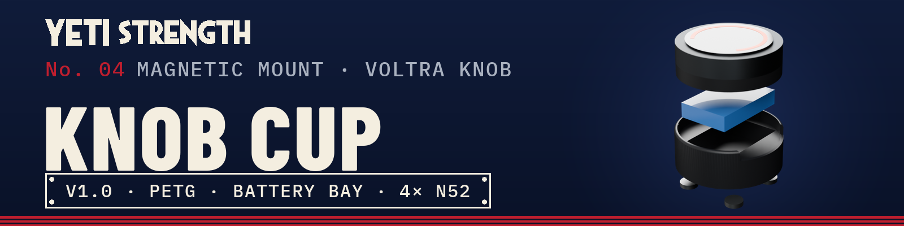
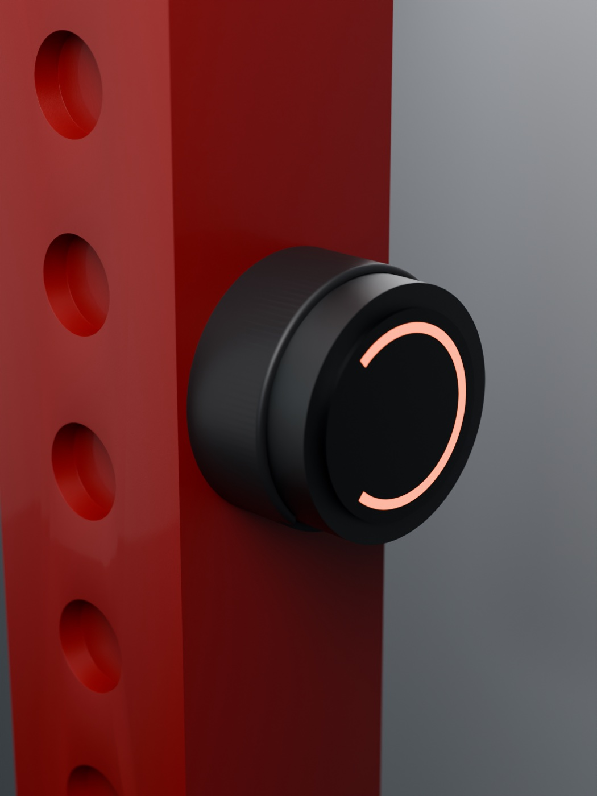
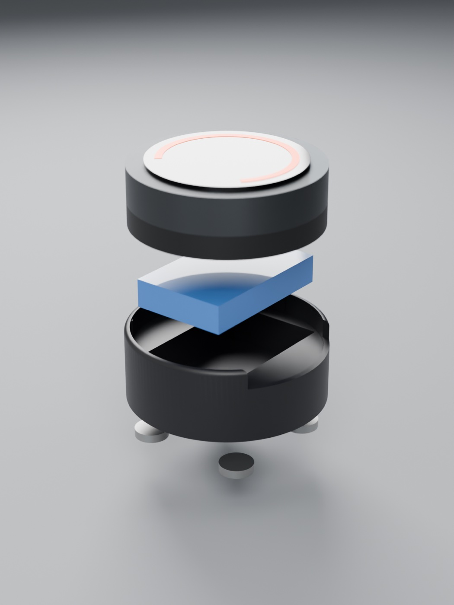
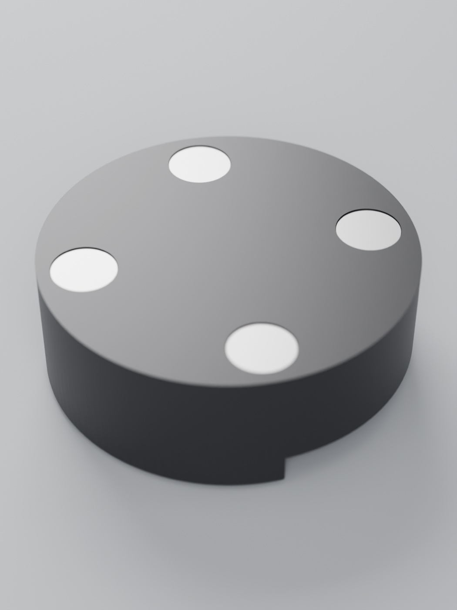

<a href="https://github.com/Schnibbz"><b>← YETI STRENGTH home</b></a> · all gear by <a href="https://github.com/Schnibbz">Schnibbz</a>

A printed cup for the **Waveshare ESP32-S3-Knob-Touch-LCD-1.8** round knob when it's used as a VOLTRA I remote. The knob
presses into the top, a bigger LiPo sits in the bay underneath it, and four N52 magnets in the bottom hold the whole thing on
any steel rack upright. Pull it off to charge it or swap the battery. Nothing gets bolted to the rack.

> **Status, v1.0:** the knob fit was tuned over three prints and holds snugly. The 12 × 3 mm magnet pockets are new in this
> version, and how well it holds on a rack under a hard bump **hasn't been tested yet**.

## What's in it

| Feature | Detail |
|---|---|
| Knob socket | Ø66.3 mm, 8 mm deep, with 4 crush ribs (Ø65.6 across the ribs) for a press fit on the Ø66.0 knob base. The rim stops just under the knob's turning ring. |
| Port window | 46 mm wide, open from 1.5 mm above the knob's base, so the USB-C plug and the power switch stay reachable with the knob seated. |
| Battery bay | 54 × 36 × 13 mm: a 52 × 34 × 10 mm LiPo plus 2 mm on top for the leads. |
| Magnets | 4 × Ø12 × 3 mm N52 discs in pockets from the bottom, sitting 0.25 mm below the face. |
| Top edge | R1.6 round on the outside so the cup blends into the dial. |
| Size | Ø70.3 × 25.9 mm, about 36 g in PETG |

## Files

| File | What |
|---|---|
| [`print/yeti-knob-cup-X1C-P1S-PETG.gcode.3mf`](print) | **Ready to print** on a Bambu X1 or P1 series (stock Generic PETG profile, textured PEI plate). About 1 h 15 min. |
| [`print/yeti-knob-cup.stl`](print) | The cup for any slicer |

**Print settings:** PETG or PETG-CF. Print it standing on its bottom face, the way the STL is oriented. 6 walls, 25 % gyroid
infill, 0.2 mm layers, no supports. If you use a different PETG, check the knob still presses in firmly before you glue the
magnets.

## Parts

| Qty | Part |
|---|---|
| 1 | [Waveshare ESP32-S3-Knob-Touch-LCD-1.8](https://www.waveshare.com/esp32-s3-knob-touch-lcd-1.8.htm) ([wiki](https://www.waveshare.com/wiki/ESP32-S3-Knob-Touch-LCD-1.8)) |
| 4 | N52 neodymium disc magnets, **12 × 3 mm** (genuine N52; many cheap listings are weaker and undersized) |
| 1 | 3.7 V LiPo, **52 × 34 × 10 mm** ("103450" size, about 2000 mAh), with a connector that matches the knob's battery plug |
| | CA glue or epoxy for the magnets |

## Build it

1. **Magnets.** Glue one into each pocket, pushed all the way in so it sits just below the face. For sticking to a steel rack
   the polarity doesn't matter. Let the glue cure before you load it.
2. **Battery.** The knob's own cell is small (800 mAh). The bay takes a much bigger flat LiPo under the knob instead: open the
   knob (4 screws on the bottom), drill a small hole in the centre of its bottom case, and run the new battery's lead through
   it to the battery connector.
   - **Check the polarity before you plug it in.** Small LiPos with the same connector don't all wire it the same way. Compare
     the red and black wires against the knob's original battery.
   - Close the knob, lay the battery in the bay, and tuck the lead into the 2 mm gap above it.
3. **Seat the knob.** Line the USB-C port and the power switch up with the window and press the knob straight down until its
   base bottoms out. The ribs hold it; pull it straight up to take it out.
4. **Stick it on the rack.** Any flat steel face works. It comes off with a straight pull.

## Fit notes

- The socket is sized from a calipered Ø66.0 knob base. If yours is loose, the crush ribs are the place to tune.
- Lithium batteries don't like heat or being crushed: don't leave the cup in a hot car, and replace a battery that puffs up.

## License

[CC BY-NC-SA 4.0](https://creativecommons.org/licenses/by-nc-sa/4.0/): make it for yourself, share it and remix it with credit.
**Not for commercial use**, and remixes keep the same license.

VOLTRA and Beyond Power are trademarks of Beyond Power. Waveshare is a trademark of Waveshare. This is an independent design, not
made or endorsed by either. The knob in the pictures is a simplified stand-in, not a model of the real product.

 

